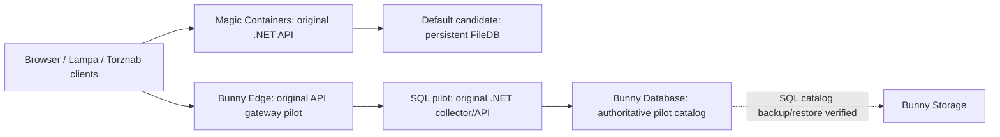
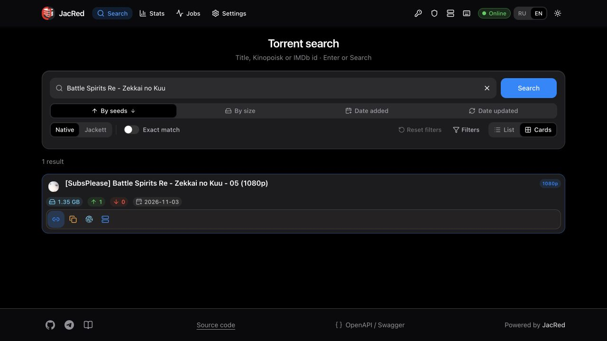

<div align="center">

# JacRed Bunny

### JacRed on bunny.net — no VPS

An independent AGPL fork of [JacRed](https://github.com/jacred-fdb/jacred), adapting its .NET torrent metadata search service to bunny.net.

[](https://github.com/vbrekher/jacred-bunny/actions/workflows/build.yml)
[](https://github.com/vbrekher/jacred-bunny/actions/workflows/bunny-native-edge.yml)
[](LICENSE)

**Development preview · v1.0.0 has not passed production acceptance**

[Installation: Русский · English · Nederlands](bunny/README.md) · [Acceptance matrix](docs/ACCEPTANCE_MATRIX.md) · [Upstream documentation](https://docs.jacred.stream)

</div>

## What works today

| Component | Verified state |
| --- | --- |
| Original .NET application | 1,081 local tests passed; original collector/query verified in a SQL-backed Magic Container pilot |
| Magic Containers | HTTPS source/backend attestation, digest-pinned update and SQL persistence across stop/start verified |
| Bunny Database | 22 real SubsPlease releases collected in-cloud; typed SQL, FTS, concurrency and read-only separation tested |
| Edge API | Original API gateway deployed to owned staging; 101 live HTTP comparisons and six Torznab XML cases passed |
| Bunny Storage | Checksum-verified SQL catalog restore after source loss; Tracks/config/jobs recovery remains open |
| 25 original tracker adapters | Source roster preserved; live parser readiness is not established |
| Native worker, durable scheduler and client acceptance | In progress; no production claim |

The standard setup still installs the FileDB candidate. An explicit SQL pilot now runs the original collector and search service against Bunny Database, with 22 real releases and verified restart persistence of the original 20-record snapshot. The original API also ran behind the real Bunny Edge gateway. This is not production acceptance or a general nonempty legacy migration. [Live gateway evidence and limits](docs/evidence/live-edge-gateway-2026-11-03.json) identify the exact scope. Staging compute is stopped after each bounded test window; these endpoints are not an always-on public demo.

TLS-hardened live collection and source announce-probe safeguards are recorded in the [changelog](CHANGELOG.md). Source SQL snapshot checks now page one consistent read session; a local dataset exceeding the former 8 MiB response limit matches an independent verifier. Catalog writes also use transport pages in one atomic transaction, retaining durable commit receipts. Bucket, index and receipt reads also page one consistent transaction. Per-row transport limits, whole-bucket memory, deadlines and complete large-catalog acceptance remain open.

Private local migration and HTTP capture tools now refuse output symlinks and preserve files created during validation. [Filesystem regression evidence](docs/evidence/private-publication-2026-11-04.json) records the reproduced data-loss risk and 193 passing Python tests; general live FileDB migration remains incomplete.

A separate [legacy byte export mode](bunny/LEGACY_EXPORT.md) now prepares a private, bounded archive without starting normal writers. Actual local HTTP verified archive hashes, authentication, absent collector routes and deadline shutdown. It is a development building block: owned-volume cloud migration and nonempty SQL import remain incomplete.

The CLI now journals owned legacy export and environment compensation. A graceful shutdown receipt binds the normal process, build and persisted master; a bare asynchronous save response is insufficient. [Local checkpoint/controller evidence](docs/evidence/legacy-checkpoint-controller-2026-11-04.json) records actual normal shutdown and archive verification, with control-plane failure cases explicitly simulated. Current local source passes 1,081 .NET and 230 Python tests; cloud migration acceptance remains open.

Historical rollback-payload recovery now verifies actual SQL migration receipts against pinned source bytes before repairing local metadata. [Recovery and live attempt evidence](docs/evidence/historical-payload-reconstruction-2026-11-04.json) records the read-only cloud reconciliation, exact Alpine image test and failed owned-volume export. The legacy app was stopped after environment compensation; cloud export and nonempty SQL migration remain incomplete.

The paged SQL image was deployed and its MC/Edge snapshot, auth and no-store checks matched the retained 22-record catalog. The subsequent collector call produced no fresh commits; it is not new write-path acceptance. [Current runtime evidence](docs/evidence/live-paged-runtime-2026-11-03.json).

The subsequent administrative-key hardening image also passed a real nonempty MC/Edge search and config-schema permission checks. [Latest runtime evidence](docs/evidence/live-admin-key-boundary-2026-11-04.json). Compute remains bounded staging, not an always-on demo.

## Install the FileDB deployment candidate

You need a bunny.net account, `curl`, and Python 3.9+ on macOS or Linux. Docker, local .NET builds and a GitHub PAT are not required when the public GHCR registry is available.

Download and inspect the installer before running it:

```sh
curl -fsSL https://raw.githubusercontent.com/vbrekher/jacred-bunny/main/install-bunny.sh -o /tmp/install-jacred-bunny.sh
sh /tmp/install-jacred-bunny.sh
```

The shorter form trusts the current remote installer immediately:

```sh
curl -fsSL https://raw.githubusercontent.com/vbrekher/jacred-bunny/main/install-bunny.sh | sh
```

The bootstrap resolves one exact GitHub commit and downloads its CLI modules. It reuses an authorized Bunny CLI profile or prompts for the account key. Verify the downloaded source and pin the URL to a reviewed commit for stronger repeatability. The legacy setup still asks before creating paid resources.

Useful commands:

```sh
jacred-bunny plan --data-gb 1 --hours 1
jacred-bunny doctor
jacred-bunny status
jacred-bunny stop
jacred-bunny start
jacred-bunny native-staging plan
```

`native-staging provision` is an advanced, journalled Database/Storage/Edge infrastructure operation. It does not install a SQL collector or make the preview production ready. [Control-plane reference](bunny/NATIVE_STAGING.md).

## How it works



The target architecture moves the authoritative catalog and job state into SQL, keeps collection and media processing in Magic Containers, and serves compatible APIs through Edge. That transition is not complete.

## Clients and trackers

JacRed exposes native, Jackett, Torznab and Prowlarr-compatible routes. The original roster contains 25 tracker IDs. Source compatibility tests do not establish live availability or successful testing with actual Lampa, Samsung Tizen, Prowlarr, Sonarr or Radarr clients. Those production gates remain open.

Playback requires a separate service such as [TorrServer-bunny](https://github.com/vbrekher/TorrServer-bunny). JacRed indexes metadata; it does not stream video. Use sources and content you are authorized to access. Tracker credentials and cookies remain private.

## Costs and operations

Hosting is metered. On 3 November 2026 the published rates include CPU at $0.02/core-hour, RAM at $0.005/GB-hour and provisioned volumes at $0.10/GB-month. Egress is separate. The first Edge request activates a $0.22 billing increment; Database is free during public preview. Check the [current Magic Containers rates](https://bunny.net/docs/magic-containers/pricing.md), [Edge rates](https://bunny.net/docs/scripting/pricing.md), [Storage rates](https://bunny.net/docs/storage/pricing.md) and [Database pricing](https://bunny.net/database/).

A single region and replica reduce exposure but do not create a hard spending limit. Stopping compute retains billable volumes. Never delete or reuse another project's resources. Staging uses a compute expiry watchdog (one hour by default, shorter windows for live checks); it is a temporary test environment, not a permanent public demo.

## Real interface

This screenshot shows the real Bunny Edge endpoint serving a cloud-collected SQL release. English native search and Russian Jackett search worked. Saving the API key retried the same query without a reload, fixing the earlier browser defect. This does not establish full client or 25-tracker acceptance.



## Documentation and release status

- [Acceptance matrix](docs/ACCEPTANCE_MATRIX.md) and [machine-readable gates](docs/acceptance.json)
- [Native rewrite plan, Russian](docs/BUNNY_NATIVE_REWRITE_PLAN.ru.md)
- [Installer and client guide, RU/EN/NL](bunny/README.md)
- [Historical README and milestone notes](README.history.md)
- [Security policy](SECURITY.md)

Complete, equivalent English/Russian/Dutch documentation, native one-command installation, backup/restore acceptance, client tests and a verified v1.0.0 release remain required. No v1.0.0 tag or production-ready badge is published before those gates pass.

## License and thanks

[AGPL-3.0](LICENSE). JacRed Bunny is a fork, not an official bunny.net product. Thank you to the original JacRed authors and maintainers: the application, tracker adapters and client contracts originate from their work. Original attribution and license remain in the source. Operators of modified network services must provide the corresponding source under the AGPL.
