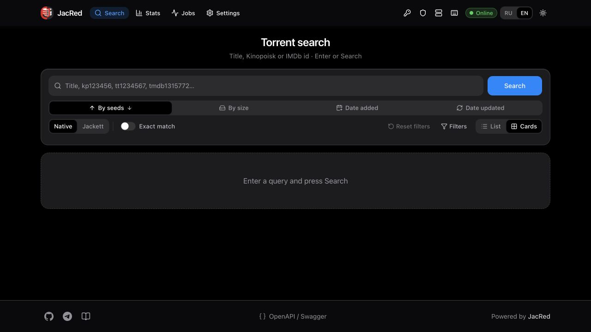
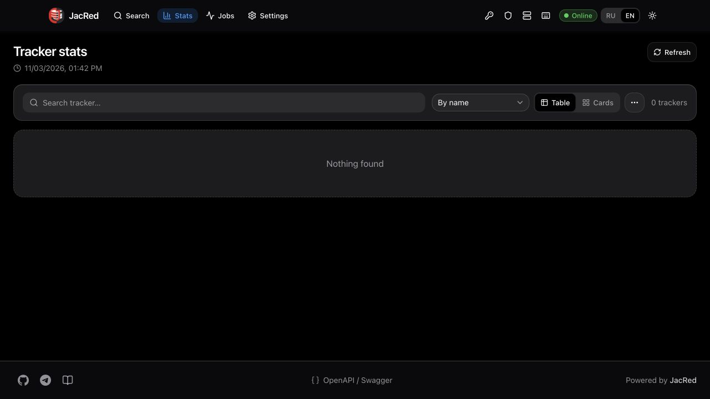

# Isolated live staging — 3 November 2026

**Infrastructure smoke only. Catalog empty. Production acceptance has not passed.**

## Source and CI

- Baseline `main`: `878c4e89e17ce833d287cab1fe128791bb5e8fc3`.
- [PR #10](https://github.com/vbrekher/jacred-bunny/pull/10) merged after [Build CI](https://github.com/vbrekher/jacred-bunny/actions/runs/41645714194) and the Edge/import workflows passed.
- Local .NET 10.0.403: **946/946** tests passed. Baseline Edge: **91/91**. Current Python infrastructure tests: **95**, pending final rerun in CI.
- [Exact-source image build](https://github.com/vbrekher/jacred-bunny/actions/runs/41646124398): source `97b22ee77d046f9ade64fe9b3926b16c8b611e9f`.
- Deployed immutable OCI digest: `sha256:ad3ab88ce7b85ef670cc62494bdc993b0c36373c8abdc099e2bf03e97b049669`.
- The first `:main` image reported stale source `09a1ffa8`. It was replaced; `/version` now reports `97b22ee7`. The stale image was never accepted as the baseline.

## Owned resources

These resources were created specifically for this work. Existing resources belonging to other products were not changed.

| Service | Resource | State at test time |
| --- | --- | --- |
| Magic Containers | `D1KyIP11ZdLNr7A` | Active, one AMS region/replica, digest pinned |
| .NET HTTPS | [Temporary worker](https://mc-5ge5797xat.bunny.run) | Health 200; empty FileDB |
| Database | `db_01M6GT0H8ST26CDNRHPB3EPJM7` | One AMS primary, EU storage; migrations 0001/0002 applied |
| Storage | `2034361` / `jacred-bunny-staging-20261103` | One DE region; synthetic transport object only |
| Edge | `100720` | Preview code published; separate read-only SQL token |
| Edge HTTPS | [Temporary Edge health](https://jacred-bunny-staging-20261103.bunny.run/health) | Correct `503 NOT_READY`, not a working search demo |

Worker compute has a one-hour stop watchdog. These URLs are temporary and are not advertised as permanent demos. Stopping compute does not delete volumes or the other resources.

## Actual observations

[HTTP evidence](http-live-evidence.json): .NET health/version 200, unauthenticated search 401, authenticated empty search 200, authenticated Torznab caps 200. Edge missing-key search 401, authenticated search and health 503 because no catalog manifest is published. Responses carry `Cache-Control: no-cache`.

[SQL evidence](sql-live-evidence.json): real Bunny writes, reads, update, delete, FTS5, transaction rollback and read-only write denial succeeded. The records were explicitly synthetic probes. This does not establish real tracker ingestion, schema completeness, golden parity or multi-shard acceptance.

[Storage evidence](storage-live-evidence.json): actual PUT returned 201; subsequent GET matched the payload's SHA256. The payload describes this staging run. It is not a production catalog backup, and no production restore is claimed.

20 sequential HTTPS health samples measured client wall-time p50 **104.20 ms**, p95 **125.68 ms**, p99 **130.33 ms**. These are not Edge CPU timings, load tests or production SLOs.

## Costs and safety

Published [MC rates](https://bunny.net/docs/magic-containers/pricing.md): CPU $0.02/core-hour, RAM $0.005/GB-hour, volumes $0.10/GB-month. Observed account limits were 8 cores and 32 GiB per pod, giving a conservative compute envelope of $0.32/hour. Two allocated 1 GB volumes cost $0.20/month while retained. Traffic is separately metered; there is **no hard cost guarantee**.

[Edge](https://bunny.net/docs/scripting/pricing.md) activates a $0.22 minimum billing increment after requests. [Storage](https://bunny.net/docs/storage/pricing.md) has metered storage and a published monthly minimum. [Database](https://bunny.net/database/) is free during public preview as checked on the test date. These are published prices, not measured final invoice totals.

The live Database API rejected a 29-character name with HTTP 400 and a 16-character maximum. The checked OpenAPI described a looser limit. The control plane enforces the real limit. Account API error bodies are omitted from ordinary installer logs because other endpoints may echo secrets.

## Real screenshots

Screenshots contain no keys, cookies, passkeys or fabricated search results. They prove UI rendering only. Remaining gates are tracked in the [acceptance matrix](../ACCEPTANCE_MATRIX.md).
